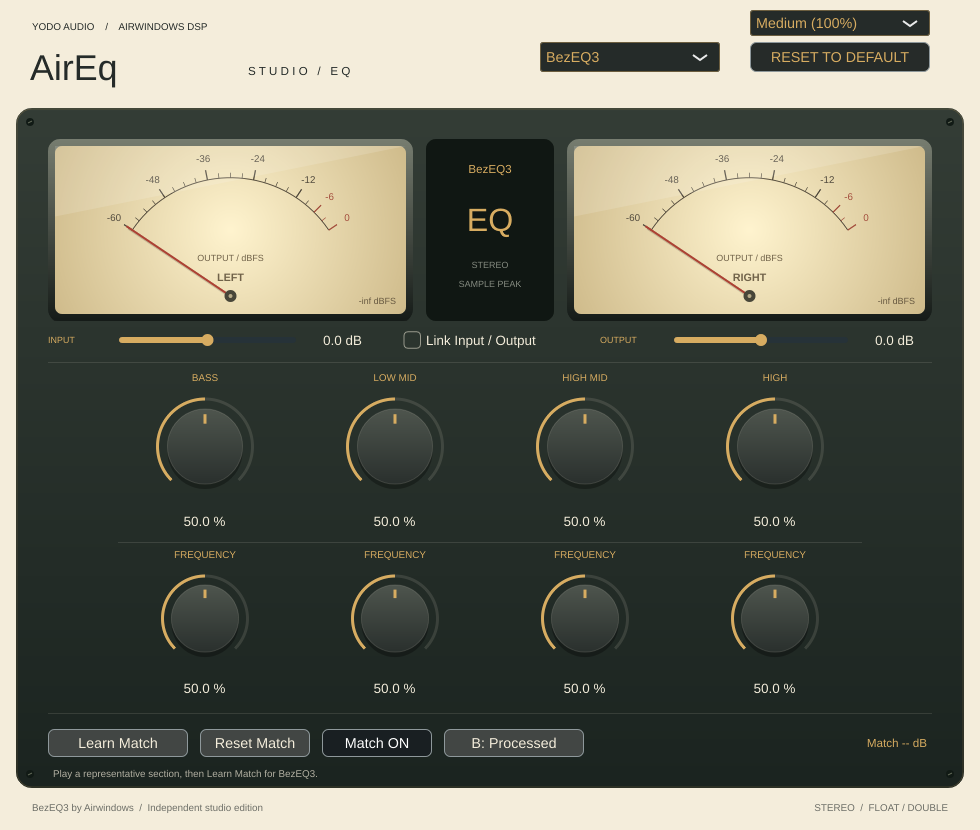

# AirEq Studio

A native studio UI for **Airwindows PearLiteEQ, BezEQ3, FatEQ, SmoothEQ3, SmoothEQ2 and PearEQ**, using the cream,
charcoal and brass style of [ToTape Studio](https://github.com/johandoornenbal/tape).
**PearLiteEQ is the default.** Built with JUCE as a **VST3 for Apple Silicon Macs
(M2 and later)**, macOS 11+. Independent adaptation; original DSP by Chris Johnson / Airwindows.


Choose the EQ from the top selector. Each has its own automatable parameter bank,
input/output trims, gain link, learned LUFS adjustment, Match ON/OFF and
Original/Processed setting. Switching retains each model's settings; the DAW
session saves them all. The selected model takes effect at the next audio block.
Entering an algorithm resets its filter history; switch with playback stopped or
at a quiet point to avoid a discontinuity. The design keeps model controls and
state separate so additional EQs can be added later.

## Controls

The controls follow each original plugin, displayed from low to high bands:

| Model | Original controls | Defaults |
| --- | --- | --- |
| PearLiteEQ | Bass, Low mid, High mid, High | 50% |
| BezEQ3 | Four band levels and four frequency controls | 50% |
| FatEQ | Bass, Low mid, High mid, High, EQ output | Tone 50%, EQ output 100% |
| SmoothEQ3 | Bass, Mid, High | 50% |
| SmoothEQ2 | Four band levels and four frequency controls | 50% |
| PearEQ | Sub, Bass, Low mid, Mid, High mid, High | 50% |

PearLiteEQ, FatEQ, SmoothEQ3 and PearEQ retain their fixed crossovers.
BezEQ3 and SmoothEQ2 show the four original frequency controls below the gains.
FatEQ's **EQ output** is Chris's original gain before his ClipOnly2 stage,
separate from the wrapper Output trim. All processing bodies, including FatEQ's
saturation, clipping and dithering, are unchanged. Frequency controls retain their
original normalized mappings, including interactions and sample-rate dependence;
they are deliberately shown as percentages, not invented Hz values. These are
not conventional independent parametric bands.



[FatEQ](docs/ui-fateq.png) · [SmoothEQ3](docs/ui-smootheq3.png) ·
[SmoothEQ2](docs/ui-smootheq2.png) · [PearEQ](docs/ui-peareq.png)

Double-click a knob to reset it, or type a value below it. **Reset to Default**
resets only the selected EQ's tone/frequency controls and input/output trims.
It preserves linking, learned matching, Match ON/OFF, A/B, and the other EQ.
Relearn matching after changing the EQ or trims.

**Input / Output trims** are separate wrapper gains, −24 to +24 dB, default 0 dB,
with 20 ms ramps. Input sits before the EQ; Output sits after it and before LUFS
matching. Double-click a trim for unity. **Link Input / Output** makes editor input
edits move output by the opposite dB amount, preserving the current gain balance.
Output edits establish a new balance. Compensation clamps at the output range and
recovers the reference when input returns within range. Both edits are reported
to the host as automation gestures. Automation playback and state recall keep
independent values and do not compensate a second time. Linking defaults off,
separately for each EQ. This is gain linking, not loudness matching.

Choose **Small (75%)**, **Medium (100%)**, or **Large (125%)** at the top right.
The entire interface scales, and the session remembers the size per instance.
Tooltips describe the controls.

The illuminated stereo output meters show the final audible sample peaks, after
trims, matching and A/B, with 120 ms attack and 450 ms release damping and a
−60 dBFS floor. They are sample-peak displays, not VU, loudness or true-peak meters.
Stereo input/output; float and double processing. FatEQ retains its original
one-sample ClipOnly2 delay and reports that latency to the host. The other models
report zero fixed latency.

## LUFS comparison and level matching

Play a representative section and click **Learn Match**. It measures the original
input against the processed signal, including both trims but before compensation.
Learning collects 15 seconds of audible, input-gated windows (about 15.3 seconds
of continuous audio). Silence pauses learning. **Finish Learning** can finish
after at least three seconds of accepted windows (about 3.3 seconds of continuous audio).

The readout shows the signed match gain, with measured input and unmatched EQ
LUFS underneath. Measurement uses stereo BS.1770 K-weighting, 400 ms windows,
100 ms hops, and absolute/relative loudness gates, checked against libebur128.
The learned gain is fixed after measurement, ramps over 20 ms and is capped at
±24 dB. It is not continuous automatic gain control or a limiter; positive gain
can exceed available headroom. Relearn after changing the source or EQ settings.

- **Match ON/OFF** applies or disables the selected EQ's saved adjustment.
- **A: Original / B: Processed** compares untouched input with the EQ path including
  trims and enabled matching, using a 5 ms crossfade. The EQ keeps processing while
  Original is selected. FatEQ Original and host bypass receive one sample of delay to align with its original output stage. The other models need no extra fixed delay for comparison.
- **Reset Match** clears only the selected EQ's learned result; all EQ parameters,
  trims, linking, Match ON/OFF and A/B preferences remain as set.

Changing model cancels learning and preserves the last successful adjustment.
Host bypass pauses measurement. Silent, short or failed measurements preserve the
last successful result. New instances have no learned adjustment and open on
Processed. Matching defaults enabled but applies unity until a match is learned.

## Sessions from v0.1

The original 23 host parameter IDs and indices are preserved. Existing saved
PearLiteEQ/BezEQ3 settings, selected model and learned matches are retained; the
new banks receive the upstream defaults. The model selector now has six choices,
so existing host automation for that selector may need updating to its expanded
range. Other automation parameters keep their original ranges and indices.
Switch algorithms with playback stopped so the host can update FatEQ's one-sample
latency compensation.

## Build, sign and install on your Mac

Install Xcode Command Line Tools (`xcode-select --install`) and CMake 3.22+
(`brew install cmake`), close your DAW, and run from this repository:

```sh
bash scripts/build-sign-install-mac.sh
```

Following Tape's workflow, this builds and tests the native arm64 VST3, signs a
staged copy, verifies the signature, then installs it to:

`~/Library/Audio/Plug-Ins/VST3/AirEq Studio.vst3`

An existing installation is replaced only after the new bundle passes signing
and verification. If replacement fails, the script attempts to restore the prior
installation. No `sudo` is used. Restart your DAW or rescan plugins afterwards.
Run from a native Apple Silicon terminal with Rosetta disabled. Supported hardware
is M2 and later; Intel and universal releases are not built. Ad-hoc signed, not
notarized. This is a VST3; Logic Pro needs AU and cannot load this target.

To sign and install an already downloaded and extracted bundle:

```sh
bash scripts/build-sign-install-mac.sh --install-only "/path/to/AirEq Studio.vst3"
```

Optional `AIREQ_BUILD_DIR` / `AIREQ_INSTALL_DIR` override the folders. Extra CMake
arguments pass through, for example `-DJUCE_PATH=/absolute/path/to/JUCE`.
The first configure downloads pinned JUCE 8.0.12 unless supplied locally.
The default bundle output is:

`build-mac/AirEqStudio_artefacts/Release/VST3/AirEq Studio.vst3`

GitHub Actions builds, tests, ad-hoc signs, verifies and archives the macOS arm64
VST3 on pushes. Linux development checks do not verify macOS compilation, signing
or DAW playback; those require a Mac.

## Development checks

Without JUCE or GUI dependencies:

```sh
cmake -S . -B build-dsp -DAIREQ_DSP_ONLY=ON -DCMAKE_BUILD_TYPE=Release
cmake --build build-dsp --parallel 3
ctest --test-dir build-dsp --output-on-failure
```

For full checks in the managed Debian Linux development instance, run
`bash scripts/setup-cloud.sh`; source `scripts/cloud-env.sh` in subsequent shells.
This installs pinned tools and JUCE plus development packages into a rootless
sysroot outside the repository, then builds the Linux test VST3. Linux builds
are for development validation; releases target Apple Silicon Macs.

Upstream comparison tests cover both precisions, silence, extremes, sample rates
44.1–192 kHz, parameter changes and variable block sizes with matched noise seeds.
Loudness tests compare the analyser with independent libebur128 results.
Wrapper tests cover default model, routing, model-specific latency, all six
model banks, typed/reset
controls, trim linking and host gestures, session/size recall, metering and actual
editor rendering. Matching tests exercise learning, automatic completion,
compensation placement, relearning, exact dry A/B, model isolation, session recall,
reset, cancellation, bypass and silent input. Editor checks write preview PNGs
for all six models in all three sizes to the build directory.

## Licenses

Airwindows DSP and wrapper/UI: MIT. JUCE is separately licensed under AGPLv3 or
commercial terms; the wrapper license does not relicense JUCE.
See [THIRD_PARTY.md](THIRD_PARTY.md) for source pins and attribution.

## Validation in this development instance

Linux Release VST3 compilation passed, with all nine CTest suites passing.
All six EQ engines passed 96 exact upstream comparisons each (576 total, maximum
absolute error 0). LUFS analysis matched independent libebur128 results at
44.1/48/96/192 kHz. All six editors rendered at all three sizes; the images above
come from the actual plugin editor at neutral settings.

The unchanged Mac installer previously passed shell syntax checks and simulated
success, signature
verification failure and replacement failure checks, preserving the existing
installation in both failure cases. Simulation does not validate Apple's signing
tools. Native macOS compilation, signing and DAW playback have not been run in
this Linux instance. The macOS workflow is provided to perform the native build.
